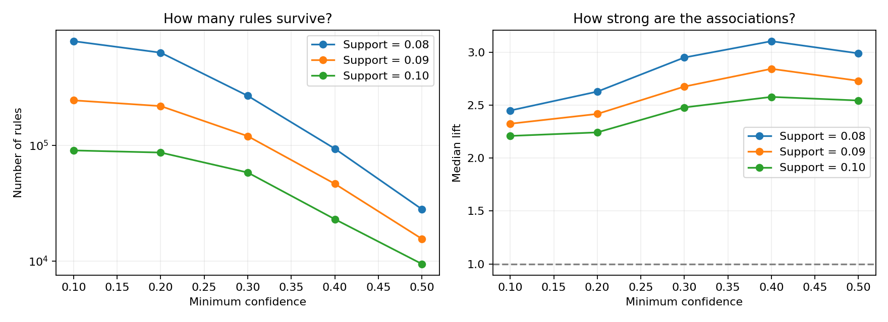

## Data Preprocessing

We used the [MovieLens 100k Small Dataset](https://www.kaggle.com/datasets/fuzzywizard/movielens-100k-small-dataset), downloaded directly from the link provided in the assignment. Its [README](dataset/README.txt) identifies the dataset version as `ml-latest-small`, containing 100,836 ratings from 610 users.

### 1. Data filtering and binarization

Ratings >= 3.0 were treated as positive interactions, meaning the user liked the movie. Lower ratings were discarded, and duplicate user-movie pairs were removed so each movie appeared only once per user. Users with fewer than five unique liked movies were then excluded.

The final filtered dataset contains 81,759 positive interactions, covering 608 users and 8,452 movies. Two users were removed by the activity filter.

The rating threshold first retained **81,763 interactions**. Of the original 610 users, one had no positive interactions and another had four; neither could form an eligible basket. Filtering therefore removed only four additional interactions. About **81.1% of the original ratings** remain in the final dataset.

### 2. Forming the transactional dataset

The filtered interactions were grouped by `userId`. Each user became one transaction containing a list of their unique liked movie IDs. Membership in this basket represents a positive interaction, so an explicit binary column is unnecessary.

This produces 608 transactions, saved as `processed/transactions.json`. Movie titles and genres were joined in the notebook to make the baskets easier to inspect.

### 3. Splitting the data

Whole user transactions were randomly split into 80% training and 20% test data, using `random_state=42` for reproducibility:

1. Training set: 486 transactions, saved as `processed/train.json`.
2. Test set: 122 transactions, saved as `processed/test.json`.

Checks confirmed that baskets contain unique movies, every retained user meets the minimum activity requirement, and no user appears in both splits.

### Some notes

- The raw ratings and movie tables had no missing values, and there were no duplicate user-movie ratings.
- Basket sizes vary widely: the median is **61.5 movies**, while the largest contains **2,117**. The smallest retained basket contains **10** despite the required minimum being five.
- Movie popularity is uneven: **Forrest Gump** appears in **258 training baskets**, while **3,072 movies** appear in only one.
- **558 distinct test movies** are absent from training. Training contains about **87% of the distinct movies in the test baskets**; the remaining 13% cannot be recommended by rules learned solely from training. This percentage counts distinct movies, not users or rating interactions.
- A movie missing from a basket means **no retained positive interaction**, rather than necessarily a dislike.

## Association Rule Mining

### 1. Mining the rules

Only the 486 training baskets were used. They were converted into a binary matrix with **486 users and 7,894 movies**: a cell is `True` when the movie appears in that user's basket.

[FP-growth](https://rasbt.github.io/mlxtend/user_guide/frequent_patterns/fpgrowth/) was used to find frequent movie combinations. It builds a compact tree of transactions and avoids explicitly generating candidate itemsets, making it a useful choice for baskets with many movies.

From each frequent combination, one movie was placed on the left and all remaining movies on the right, producing rules of the required form **{A} -> Y**. Every qualifying rule has exactly one antecedent movie and one or more consequent movies. No maximum itemset length was imposed.

The selected thresholds produced **9,425 rules**, saved in `mining_results/rules.json` with movie IDs, readable titles, support, confidence, and lift. The observed consequent sizes range from **one to five movies**.

These are **all rules meeting the selected thresholds and required structure**, not just the top 100. Of them, **3,035** have a single consequent movie and **6,390** have multiple consequent movies.

### 2. Experimenting with thresholds

We tested minimum support values **0.08, 0.09, and 0.10**, and minimum confidence values **0.10, 0.20, 0.30, 0.40, and 0.50**: **15 combinations** in total.

- **Support:** the fraction of training baskets containing all movies in the rule: `count(A and Y) / 486`.
- **Confidence:** among users who liked the antecedent, the fraction who also liked all consequent movies: `count(A and Y) / count(A)`.
- **Lift:** confidence divided by the consequent's overall frequency: `confidence / (count(Y) / 486)`. A value above one indicates a positive association.

The graphs compare rule counts and median lift as confidence changes, with a separate curve for each support value. Results are saved in `mining_results/threshold_results.csv`.

At minimum confidence **0.50**, the results were:

| Minimum support | Number of rules | Median lift |
|---|---:|---:|
| 0.08 | 28,019 | 2.99 |
| 0.09 | 15,535 | 2.73 |
| 0.10 | 9,425 | 2.54 |

### Final choice and justification

We selected **minsup=0.10 and minconf=0.50**, requiring each rule to occur in at least **49 training baskets**, with its consequent present in at least half the baskets containing its antecedent. This produces **9,425 rules**, compared with 90,248 at confidence 0.10 and 28,019 at support 0.08 with confidence 0.50. The choice favors repeated co-occurrence and a smaller rule set within the tested grid; recommendation quality remains to be evaluated.

### Conclusions from Parts A and B

Part A produced **608 eligible user baskets**, split into **486 training** and **122 test** transactions. Part B produced verified rules with median confidence **56.5%** and median lift **2.54**. These describe associations in training baskets, not recommendation precision or recall.

The rules have only **121 distinct consequent movies**, covering **1.53% of the 7,894 training movies**. This conservative setting favors popular movies and limits recommendation variety. The calculations are valid, but a large rule count alone does not establish a useful recommender.

### Moving to Part C

Next, compare the top 100 rules ranked by support and confidence and identify their overlap. For each test basket, use its first half as input and second half as ground truth, preserving the stored order. Evaluate unseen-movie recommendations for **1-10 recommendations per user**, plot average precision and recall, and discuss a few sample users. This will show how well the mined associations translate into recommendations.
