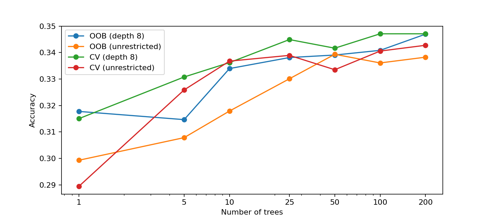
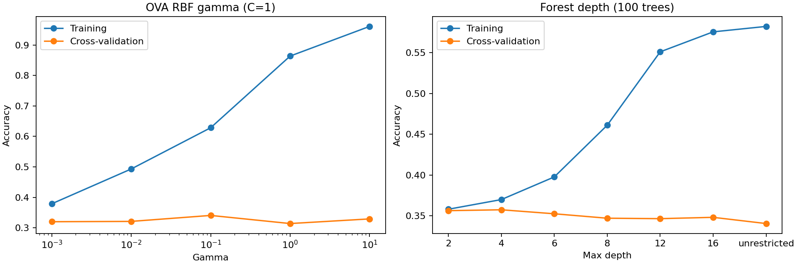
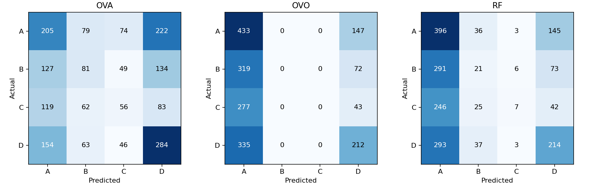

# Assignment 4: Classification

**Team 61**

OVO has the highest accuracy at **35.1%**, but never predicts B or C. OVA has the best macro-F1 of the three accuracy-selected models. None of these models is strong enough to guide outreach on its own.

| Model | Accuracy | Macro-F1 | Weighted-F1 |
|---|---|---|---|
| OVA | 0.341 | 0.310 | 0.329 |
| OVO | 0.351 | 0.215 | 0.264 |
| RF | 0.347 | 0.245 | 0.288 |

These scores use predictions for rows held out from model fitting. Macro-F1 gives each segment equal weight; weighted-F1 gives larger segments more weight.

## Task 1 - SVMs

### Data and preprocessing

We used 1,838 labelled customers and 789 unlabelled test customers. Each customer has nine predictors. `ID` was excluded, and `Segmentation` was the target. Segment definitions and the meaning of `Var_1` were not supplied.

| Inputs | Preparation |
|---|---|
| Age, Work_Experience, Family_Size | Fill with training medians, then standardize. |
| Gender, Ever_Married, Graduated, Profession, Var_1 | Fill with `Missing`, then one-hot encode. |
| Spending_Score | Fill with the training mode; encode Low=0, Average=1, High=2; then standardize. |

All preprocessing was fitted inside each training fold. Validation and test rows used that fitted transformation. The spending encoding assumes equal spacing between the three levels.

### Training and selection

- **OVA:** four binary SVMs, each separating one segment from the rest. The highest decision score wins.
- **OVO:** six binary SVMs, each trained on one pair of segments. Each model votes. Ties use summed signed decision scores, then the earliest training-row occurrence of a class. Class names and their order do not decide ties.
- **Validation:** the same five stratified folds for every model, with seed 42. Both equal and balanced class weights were tested; balancing was recalculated for each binary problem.

| Setting | Values searched |
|---|---|
| Kernel | Linear, RBF |
| C | 0.1, 1, 10 |
| Gamma | `scale`, 0.01, 0.1, 1 for RBF; unused for linear |
| Class weights | Equal, balanced |

This gives **30 configurations per method**. We kept one choice by mean accuracy and another by mean macro-F1. The other metric breaks a tie. The appendix contains every configuration’s mean and SD across five folds; SD uses `ddof=0`.

| Method | Selected by | RBF settings | CV accuracy ± SD | CV macro-F1 ± SD |
|---|---|---|---|---|
| OVA | Accuracy | C=1, gamma=0.1, equal | 0.3406 ± 0.0183 | 0.3097 ± 0.0176 |
| OVA | Macro-F1 | C=1, gamma=0.1, balanced | 0.3194 ± 0.0152 | 0.3153 ± 0.0155 |
| OVO | Accuracy | C=1, gamma=0.01, equal | 0.3509 ± 0.0196 | 0.2153 ± 0.0123 |
| OVO | Macro-F1 | C=10, gamma=scale, balanced | 0.3303 ± 0.0111 | 0.3232 ± 0.0130 |

OVO’s small accuracy advantage comes with poor coverage of the smaller segments. Selecting it by macro-F1 improves that balance, with about two percentage points less accuracy.

The final models were refitted on all labelled rows. [ova.csv](../results/ova.csv) and [ovo.csv](../results/ovo.csv) each contain 789 predictions in test-row order, in a single `predicted` column. The command-line scripts also support the separate macro-F1 choice.

## Task 2 - Random forest

### Implementation and tree count

Bootstrap sampling, feature sampling, tree growth, prediction voting and OOB accuracy are implemented in our code. At every node, we randomly choose `floor(sqrt(p))` candidate columns without replacement, where `p` is the number of prepared features.

A [one-split decision tree](https://scikit-learn.org/1.7/modules/generated/sklearn.tree.DecisionTreeClassifier.html) finds the best Gini split among those candidates (`max_depth=1`, `max_features=None`). Our code then grows both children and follows their branches during prediction. Each leaf needs at least five rows. A node stops at the depth limit, with pure labels, or when its candidates cannot make a valid split.

We tested every required tree count at depth 8 and unrestricted depth. Preprocessing and validation folds match the SVM experiments. OOB accuracy uses only trees whose bootstrap sample excluded the row; rows with no OOB vote are left out.

| Trees | Depth 8: CV | Depth 8: OOB | Unrestricted: CV | Unrestricted: OOB |
|---|---|---|---|---|
| 1 | 0.315 | 0.318 | 0.289 | 0.299 |
| 5 | 0.331 | 0.315 | 0.326 | 0.308 |
| 10 | 0.336 | 0.334 | 0.337 | 0.318 |
| 25 | 0.345 | 0.338 | 0.339 | 0.330 |
| 50 | 0.342 | 0.339 | 0.334 | 0.339 |
| 100 | 0.347 | 0.341 | 0.341 | 0.336 |
| 200 | 0.347 | 0.347 | 0.343 | 0.338 |

Accuracy generally improves as voting becomes less dependent on one tree, then levels off near 0.35. Small fluctuations are expected; adding trees does not guarantee a gain at every step. OOB coverage rises from about 37% with one tree to 99% with ten.

We selected **200 trees at depth 8**, the highest mean CV accuracy in Task 2(b), though 100 trees is effectively tied. The [notebook](../notebooks/61_random_forest.ipynb) displays all 789 predictions and saves [rf.csv](../results/rf.csv). Its validation accuracy is **0.347**, with macro-F1 **0.245**. Test predictions are A=573, B=23, C=0 and D=193. Per-class validation scores appear in Task 3 below.

Preprocessing is fitted before bootstrapping, so OOB rows still contribute to the fold’s preprocessing statistics. We therefore use five-fold CV as the main performance estimate.

### Which attributes matter?

We fitted a forest on 80% of the labelled rows and evaluated it on the remaining 20%. Held-out accuracy was **0.342**. Each original attribute was shuffled ten times, keeping its one-hot columns together through preprocessing.

| Attribute | Accuracy drop | SD across shuffles |
|---|---|---|
| Age | 0.017 | 0.007 |
| Ever_Married | 0.009 | 0.007 |
| Family_Size | 0.004 | 0.005 |
| Var_1 | 0.001 | 0.007 |

Shuffling **Age** lowers accuracy by about 1.7 percentage points, the clearest effect. Age and marital status could reflect life stage and household needs, so their positive effects are plausible. Family_Size has a smaller, less stable effect. Var_1 is close to zero and has no supplied business definition. These are associations used by this model, not causes or definitions of segments A-D.

## Task 3 - Comparison and interpretation

### Class imbalance

Class counts are A=580, B=391, C=320 and D=547. A and D account for about 61% of the data. In each OVA problem, the positive class is only 17-32% of the rows, so a classifier can favor the larger negative class while missing that segment.

We changed only the class weights for OVA with RBF, C=1 and gamma=0.1:

| Weights | CV accuracy | CV macro-F1 |
|---|---|---|
| Equal | 0.341 | 0.310 |
| Balanced | 0.319 | 0.315 |

Balancing gives a small macro-F1 improvement at an accuracy cost. For a small dataset, use stratified folds, class weights and per-class metrics. Oversampling can help, but it must happen inside each training fold; doing it before splitting leaks repeated examples into validation. Simpler models and repeated validation can also reduce unstable conclusions.

### Overfitting and underfitting

| Setting | What changing it does |
|---|---|
| SVM C | Large C penalizes training mistakes more strongly; small C regularizes more and may underfit. |
| RBF gamma | Large gamma produces more local, flexible boundaries and can overfit. Very small gamma can miss patterns. |
| SVM kernel | Linear is less flexible; RBF can represent curved boundaries but needs careful tuning. |
| Number of trees | More trees stabilize votes. They do not make each tree deeper; gains usually level off. |
| Max depth | Deeper trees fit more detail and can overfit; shallow trees can underfit. |
| Min samples per leaf | Small leaves can fit noise; large leaves smooth predictions and may miss smaller patterns. |
| Max features | More candidate features can strengthen splits but make trees more similar. Too few can weaken individual trees. |

For OVA, raising gamma from 0.001 to 10 increases training accuracy from **0.379 to 0.961**, while CV accuracy stays near **0.31-0.34**. The model is fitting training details that do not carry over to validation.

For the forest, training accuracy rises from **0.358** at depth 2 to **0.582** without a depth limit, while CV accuracy ranges from **0.341 to 0.357**. Depth 4 looks promising for further tuning. The main model comparison uses the setting selected in Task 2(b); this diagnostic curve holds the tree count at 100. All curves use the same five folds.

### Which segments are confused?

| Model | Segment | Precision | Recall | F1 |
|---|---|---|---|---|
| OVA | A | 0.339 | 0.353 | 0.346 |
| OVA | B | 0.284 | 0.207 | 0.240 |
| OVA | C | 0.249 | 0.175 | 0.206 |
| OVA | D | 0.393 | 0.519 | 0.447 |
| OVO | A | 0.317 | 0.747 | 0.445 |
| OVO | B | 0.000 | 0.000 | 0.000 |
| OVO | C | 0.000 | 0.000 | 0.000 |
| OVO | D | 0.447 | 0.388 | 0.415 |
| RF | A | 0.323 | 0.683 | 0.439 |
| RF | B | 0.176 | 0.054 | 0.082 |
| RF | C | 0.368 | 0.022 | 0.041 |
| RF | D | 0.451 | 0.391 | 0.419 |

A and D are the most confused pair in all three models: **376** errors for OVA, **482** for OVO and **438** for RF, counting both directions. OVO never predicts B or C. RF finds only about **5% of B** and **2% of C** in validation. OVA covers these smaller segments better, which is reflected in its higher macro-F1.

The summary at the start gives macro- and weighted-F1. Those scores pool all held-out predictions; the tuning tables average the five fold scores, so small numerical differences are normal.

### OVO versus OVA

OVO’s accuracy is **1.03 percentage points** higher than OVA’s. A paired bootstrap with 10,000 resamples gives a **95% interval of -1.36 to +3.54 percentage points**.

Only OVO is correct on 273 customers; only OVA is correct on 254. The exact McNemar test gives **p=0.433**. The interval crosses zero, and the test does not show a clear difference. Between these SVMs, we would choose **OVA** because it detects all four segments and has much better macro-F1.

### Baselines and practical value

Both baselines use each fold’s training-class distribution. A is the majority class in every fold. Stratified random predictions use seed 42.

| Baseline | Accuracy | Macro-F1 |
|---|---|---|
| Majority | 0.316 | 0.120 |
| Stratified random | 0.254 | 0.241 |

Among the three models selected earlier, OVO has the highest accuracy. It improves on the majority baseline by **3.5 percentage points**. A one-sided binomial test against the majority accuracy gives **p=0.000664**. This is a small p-value under the test’s assumptions, but the practical gain is modest: roughly 65% of customers are still misclassified.

Settings were selected on these same folds, and CV predictions share training data. The scores can be optimistic, and the statistical tests are approximate evidence rather than an independent test-set confirmation. The importance split was also held out from its model fit, not from the earlier selection of settings.

### Advice to the sales team

Use the predictions as a tentative aid for prioritizing outreach. Even the highest cross-validated accuracy is only about 35%, and that model entirely misses B and C. OVA gives more balanced predictions, but is still weak. Keep a general outreach option rather than excluding people based on their predicted segment. Run a small pilot and measure whether segment-specific messages improve sales. Review performance by segment before expanding. The 789 test customers have no known labels, so their prediction accuracy cannot yet be measured.

## Appendix - Complete SVM search

All 60 configurations are included below. Values are **mean ± SD over five folds**. Equal weights mean `class_weight=None`; gamma does not apply to the linear kernel. The machine-readable version is [cv_results.csv](../results/cv_results.csv).

### OVA

| Kernel | C | Gamma | Weights | Accuracy ± SD | Macro-F1 ± SD |
|---|---|---|---|---|---|
| linear | 0.1 | - | Equal | 0.2998 ± 0.0131 | 0.2749 ± 0.0244 |
| linear | 0.1 | - | Balanced | 0.3068 ± 0.0224 | 0.2962 ± 0.0264 |
| linear | 1 | - | Equal | 0.2856 ± 0.0245 | 0.2712 ± 0.0301 |
| linear | 1 | - | Balanced | 0.3063 ± 0.0335 | 0.2865 ± 0.0328 |
| linear | 10 | - | Equal | 0.2710 ± 0.0253 | 0.2609 ± 0.0208 |
| linear | 10 | - | Balanced | 0.3025 ± 0.0299 | 0.2831 ± 0.0304 |
| rbf | 0.1 | scale | Equal | 0.3313 ± 0.0218 | 0.2997 ± 0.0200 |
| rbf | 0.1 | 0.01 | Equal | 0.3145 ± 0.0188 | 0.2819 ± 0.0226 |
| rbf | 0.1 | 0.1 | Equal | 0.3368 ± 0.0189 | 0.3058 ± 0.0184 |
| rbf | 0.1 | 1.0 | Equal | 0.3177 ± 0.0095 | 0.2884 ± 0.0094 |
| rbf | 0.1 | scale | Balanced | 0.3090 ± 0.0086 | 0.3066 ± 0.0101 |
| rbf | 0.1 | 0.01 | Balanced | 0.3232 ± 0.0221 | 0.2713 ± 0.0310 |
| rbf | 0.1 | 0.1 | Balanced | 0.3052 ± 0.0106 | 0.3030 ± 0.0123 |
| rbf | 0.1 | 1.0 | Balanced | 0.2834 ± 0.0141 | 0.2390 ± 0.0126 |
| rbf | 1 | scale | Equal | 0.3330 ± 0.0213 | 0.3034 ± 0.0208 |
| rbf | 1 | 0.01 | Equal | 0.3210 ± 0.0099 | 0.2863 ± 0.0121 |
| rbf | 1 | 0.1 | Equal | 0.3406 ± 0.0183 | 0.3097 ± 0.0176 |
| rbf | 1 | 1.0 | Equal | 0.3139 ± 0.0116 | 0.2843 ± 0.0098 |
| rbf | 1 | scale | Balanced | 0.3188 ± 0.0221 | 0.3139 ± 0.0226 |
| rbf | 1 | 0.01 | Balanced | 0.3030 ± 0.0173 | 0.2968 ± 0.0221 |
| rbf | 1 | 0.1 | Balanced | 0.3194 ± 0.0152 | 0.3153 ± 0.0155 |
| rbf | 1 | 1.0 | Balanced | 0.3150 ± 0.0142 | 0.3003 ± 0.0109 |
| rbf | 10 | scale | Equal | 0.3215 ± 0.0223 | 0.3001 ± 0.0204 |
| rbf | 10 | 0.01 | Equal | 0.3210 ± 0.0082 | 0.2814 ± 0.0094 |
| rbf | 10 | 0.1 | Equal | 0.3254 ± 0.0199 | 0.3016 ± 0.0177 |
| rbf | 10 | 1.0 | Equal | 0.3047 ± 0.0162 | 0.2873 ± 0.0098 |
| rbf | 10 | scale | Balanced | 0.3199 ± 0.0115 | 0.3124 ± 0.0131 |
| rbf | 10 | 0.01 | Balanced | 0.3009 ± 0.0063 | 0.2968 ± 0.0073 |
| rbf | 10 | 0.1 | Balanced | 0.3199 ± 0.0151 | 0.3132 ± 0.0155 |
| rbf | 10 | 1.0 | Balanced | 0.3052 ± 0.0234 | 0.2888 ± 0.0212 |

### OVO

| Kernel | C | Gamma | Weights | Accuracy ± SD | Macro-F1 ± SD |
|---|---|---|---|---|---|
| linear | 0.1 | - | Equal | 0.3319 ± 0.0193 | 0.2025 ± 0.0110 |
| linear | 0.1 | - | Balanced | 0.2878 ± 0.0175 | 0.2776 ± 0.0262 |
| linear | 1 | - | Equal | 0.3335 ± 0.0093 | 0.2124 ± 0.0090 |
| linear | 1 | - | Balanced | 0.2802 ± 0.0215 | 0.2677 ± 0.0279 |
| linear | 10 | - | Equal | 0.3357 ± 0.0103 | 0.2148 ± 0.0119 |
| linear | 10 | - | Balanced | 0.2867 ± 0.0109 | 0.2752 ± 0.0134 |
| rbf | 0.1 | scale | Equal | 0.3428 ± 0.0088 | 0.2016 ± 0.0053 |
| rbf | 0.1 | 0.01 | Equal | 0.3156 ± 0.0004 | 0.1222 ± 0.0046 |
| rbf | 0.1 | 0.1 | Equal | 0.3444 ± 0.0100 | 0.2040 ± 0.0053 |
| rbf | 0.1 | 1.0 | Equal | 0.3270 ± 0.0022 | 0.1437 ± 0.0024 |
| rbf | 0.1 | scale | Balanced | 0.3101 ± 0.0123 | 0.2991 ± 0.0135 |
| rbf | 0.1 | 0.01 | Balanced | 0.3047 ± 0.0239 | 0.2340 ± 0.0261 |
| rbf | 0.1 | 0.1 | Balanced | 0.3079 ± 0.0158 | 0.2969 ± 0.0179 |
| rbf | 0.1 | 1.0 | Balanced | 0.3101 ± 0.0376 | 0.2268 ± 0.0519 |
| rbf | 1 | scale | Equal | 0.3373 ± 0.0171 | 0.2547 ± 0.0248 |
| rbf | 1 | 0.01 | Equal | 0.3509 ± 0.0196 | 0.2153 ± 0.0123 |
| rbf | 1 | 0.1 | Equal | 0.3335 ± 0.0173 | 0.2310 ± 0.0147 |
| rbf | 1 | 1.0 | Equal | 0.3221 ± 0.0222 | 0.2720 ± 0.0196 |
| rbf | 1 | scale | Balanced | 0.3090 ± 0.0163 | 0.3024 ± 0.0191 |
| rbf | 1 | 0.01 | Balanced | 0.3090 ± 0.0171 | 0.2975 ± 0.0218 |
| rbf | 1 | 0.1 | Balanced | 0.3090 ± 0.0161 | 0.3024 ± 0.0181 |
| rbf | 1 | 1.0 | Balanced | 0.3205 ± 0.0157 | 0.3035 ± 0.0158 |
| rbf | 10 | scale | Equal | 0.3286 ± 0.0134 | 0.3050 ± 0.0119 |
| rbf | 10 | 0.01 | Equal | 0.3406 ± 0.0117 | 0.2097 ± 0.0091 |
| rbf | 10 | 0.1 | Equal | 0.3254 ± 0.0241 | 0.3009 ± 0.0242 |
| rbf | 10 | 1.0 | Equal | 0.3123 ± 0.0167 | 0.2848 ± 0.0115 |
| rbf | 10 | scale | Balanced | 0.3303 ± 0.0111 | 0.3232 ± 0.0130 |
| rbf | 10 | 0.01 | Balanced | 0.3030 ± 0.0194 | 0.2961 ± 0.0240 |
| rbf | 10 | 0.1 | Balanced | 0.3232 ± 0.0129 | 0.3174 ± 0.0131 |
| rbf | 10 | 1.0 | Balanced | 0.3090 ± 0.0157 | 0.2884 ± 0.0131 |
