# Assignment 4 — Section 2

Team 61

The retailer data supports two broad customer groups: lower spending with more children, and higher spending with fewer children. The higher-spending group contains 40% of customers and accounts for 81.26% of recorded spending. These groups are useful starting points for offer testing, although their silhouette score of 0.253 shows considerable overlap.

Task 1 uses the 2,240 customers in Dataset1. Task 2 clusters the cleaned customer data. Task 3 compares clustering methods on the four coordinate datasets in Dataset2.

## Task 1 — Customer data and Power BI

### Cleaning

The original file has 2,240 rows and 29 columns, with no duplicate customer IDs. Power Query retains all rows and adds seven columns, giving a cleaned file of 2,240 rows and 36 columns. The exported CSV was checked by ID against the cleaning rules.

| Issue | Rows affected | Treatment |
| --- | ---: | --- |
| Missing income | 24 | Filled with the median of 51,381.5. |
| Income above the upper IQR limit of 118,350.5 | 8 | Flagged and retained in the exported data. |
| Birth years 1893, 1899 and 1900 | 3 | Cleaned birth year and age set to null; original year retained. |
| Marital status `Alone` | 3 | Changed to `Single`. |
| Marital status `Absurd` or `YOLO` | 4 | Changed to `Unknown`. |

The eight extreme incomes were not assumed to be data-entry errors. Keeping a flag allows their effect to be checked without losing the customers' other information. Three ages remain unknown rather than assigning unsupported birth years.

The reference date is **29 June 2014**, the latest enrollment date in the data. Using today's date would make age and tenure change each time the work is run and would describe customers long after the recorded purchases.

| Added feature | Calculation | Non-missing values |
| --- | --- | ---: |
| Age | 2014 minus cleaned birth year; approximate because birthdays are unavailable | 2,237 |
| Customer tenure | Days from enrollment to 29 June 2014 | 2,240 |
| Total spending | Sum of the six product-spending columns | 2,240 |
| Total purchases | Web + catalog + store purchases | 2,240 |
| Total children | Kidhome + Teenhome | 2,240 |

Deal purchases are excluded from the purchase total because they can overlap with the channel counts. These five features, the cleaned birth year and the income flag account for the seven added columns. Valid ages range from 18 to 74, and tenure ranges from 0 to 699 days.

### Visualizations and measures

The [Power BI report](../powerbi/61_clustering_Part1.pbix) contains education and marital-status bars, age and income distributions, an income–spending scatter plot, a correlation matrix and summary cards. Its slicers include education, marital status and income bands. The correlation matrix uses a calculated table and describes the full dataset; it does not recalculate when slicers change. The saved report structure was inspected, but live slicer behaviour was not tested.

The figures below are **Python reproductions from the cleaned CSV**, not screenshots of Power BI. They provide static views for this report; the PBIX contains the interactive version.

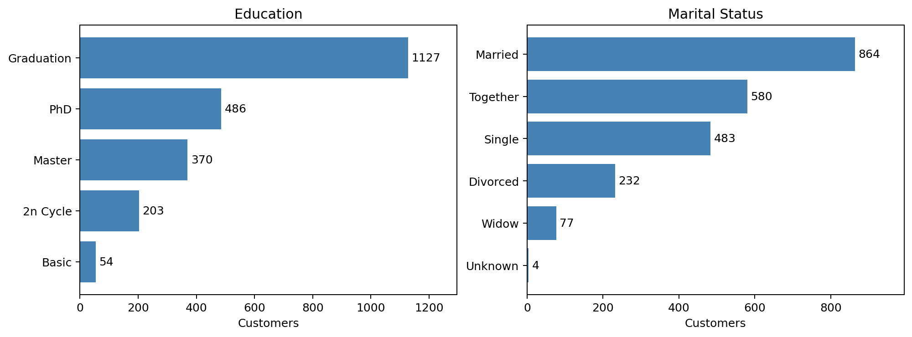

Figure 1. Customer counts after standardizing marital-status values.

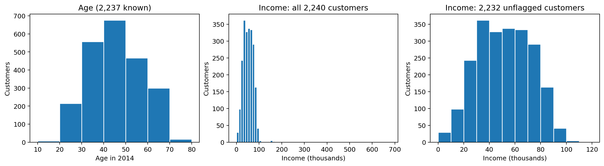

Figure 2. Age excludes three unknown values. The middle income plot includes all customers; the right plot excludes the eight flagged incomes to show the main distribution more clearly. Income bins are 10,000 units wide.

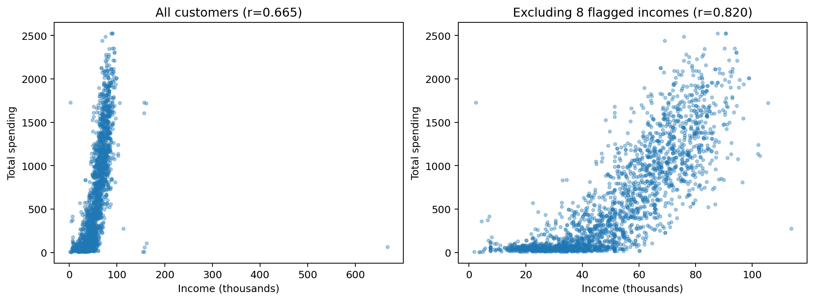

Figure 3. The extreme incomes stretch the horizontal axis and weaken the overall linear correlation. They remain in the cleaned file.

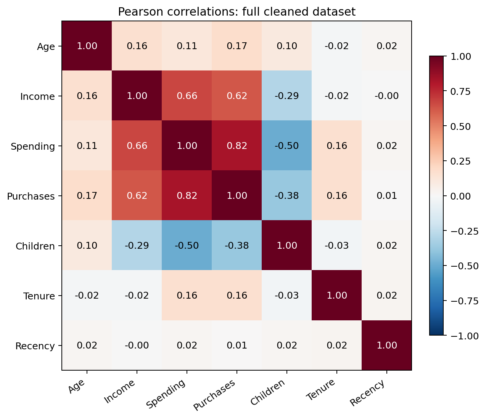

Figure 4. Pearson correlations using the available pairs of values. The three missing ages are omitted only from correlations involving age. Correlation describes association, not cause.

The DAX measures are:

```dax
Total Spending Measure =
SUM('marketing_campaign 1'[Total_Spending])

Campaign Response Rate =
DIVIDE(
    SUM('marketing_campaign 1'[Response]),
    COUNTROWS('marketing_campaign 1'),
    0
)

Total Customers =
DISTINCTCOUNT('marketing_campaign 1'[ID])
```

With no filters, these give total spending of **1,356,988 monetary units**, **334 / 2,240 = 14.91%** campaign response and **2,240 customers**. Mean spending is 605.80, while the median is 396, showing that higher spenders pull up the average. Mean income is 52,237.98, including the flagged incomes.

Five findings from the plots are:

1. Married customers (864) and those living together (580) make up **64.46%** of customers. Household-based offers are worth testing, while checking actual purchase behaviour within this group.
2. Ages **40–49** form the largest age group: **676 customers**, or **30.22%** of the 2,237 known ages. This is a sizeable campaign audience, but age alone does not establish spending potential.
3. The **30,000–39,999** income band contains **362 customers (16.16%)**. Comparing its spending and response with nearby bands could help choose suitable offers.
4. Total purchases and spending have a correlation of **0.821**. Purchase frequency is useful for identifying higher-spending customers, although it does not measure profit.
5. Income and spending correlate at **0.665**, rising to **0.820** without the eight flagged incomes. Income-based targeting should therefore be checked for sensitivity to those records.

## Task 2 — K-Means customer segments

### Features and implementation

The six clustering inputs are **Age, Income, Total Spending, Recency, Total Children and Customer Tenure**. They describe purchasing capacity, behaviour and household circumstances. Total purchases and individual product amounts are left out to reduce repeated weighting of spending. ID, Education, Complain, Response and AcceptedCmp1–AcceptedCmp5 are excluded, as are features derived from campaign outcomes.

For clustering only, a copy of the data fills the three missing ages with the median, **44**, and caps the eight flagged incomes at **118,350.5**. The exported cleaned data is unchanged. StandardScaler then gives each feature mean zero and unit variance. Without scaling, the large numerical ranges of income and spending would dominate squared distances. One-hot categories also change the distance calculation: category mismatches add distance without describing an ordered difference, and scaling rare indicators can give them excessive weight. This is why the selected inputs are numerical.

The implementation in [kmeans.py](../scripts/kmeans.py) uses NumPy, with no built-in clustering function. K-means++ chooses the first centre randomly and later centres with probability proportional to squared distance from the nearest existing centre. Each iteration assigns points to their nearest centre and recomputes the means. An empty cluster receives a far-away point from a cluster with more than one member.

The run stops when labels stop changing, the norm of the centre movement is at most the tolerance, or 300 iterations are reached. The experiments use tolerance 1e-6 and ten random restarts, keeping the lowest-inertia result.

For verification, the custom implementation and sklearn KMeans start from identical centres, with one run each and tolerance zero. Across **k=2–10**, every comparison gives **ARI=1.000** and the largest absolute inertia difference is about **1.82e-11**. This checks the Lloyd iterations independently of initialization differences: sklearn uses a greedy version of k-means++. The comparison settings are documented in the [KMeans reference](https://scikit-learn.org/1.7/modules/generated/sklearn.cluster.KMeans.html).

### Choosing the number of segments

Each k is run with five seeds and ten restarts per seed. Silhouette is calculated for the best-inertia solution; stability is the ARI across the ten pairs of seed results.

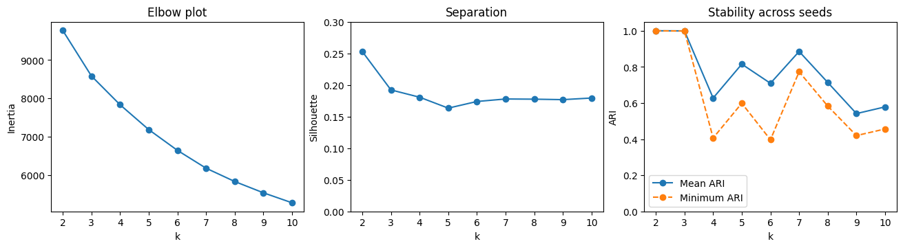

Figure 5. Inertia, silhouette and stability for k=2–10.

| k | Inertia | Silhouette | Mean stability ARI | Minimum stability ARI |
| --- | ---: | ---: | ---: | ---: |
| 2 | 9775.07 | 0.2529 | 1.0000 | 1.0000 |
| 3 | 8586.71 | 0.1922 | 0.9995 | 0.9986 |
| 4 | 7835.20 | 0.1806 | 0.6276 | 0.4065 |
| 5 | 7187.02 | 0.1634 | 0.8154 | 0.5988 |
| 6 | 6645.49 | 0.1739 | 0.7093 | 0.3966 |
| 7 | 6179.56 | 0.1778 | 0.8856 | 0.7730 |
| 8 | 5832.35 | 0.1775 | 0.7137 | 0.5829 |
| 9 | 5537.86 | 0.1768 | 0.5415 | 0.4199 |
| 10 | 5277.01 | 0.1794 | 0.5787 | 0.4564 |

There is no sharp elbow. **k=2** has the highest silhouette, **0.253**, and identical results across all five seeds. Two segments are also straightforward to use in an offer trial. More segments would add complexity without improving separation here. The modest silhouette means the groups overlap; stable results across seeds do not establish that two natural customer types exist.

Without the income cap, the two-cluster solution has **ARI=0.940** against the capped solution. Most memberships remain similar, but the income treatment still affects some customers. Income and spending are also related, so the selected features give purchasing capacity substantial influence even after scaling.

### Cluster profiles

Profiles below use original units and uncapped income. Missing ages are omitted from the age averages.

| Profile | Cluster 0: lower spending, more children | Cluster 1: higher spending, fewer children |
| --- | ---: | ---: |
| Customers | 1,344 (60%) | 896 (40%) |
| Mean income | 38,442.27 | 72,931.53 |
| Median income | 38,385.50 | 71,493.50 |
| Mean spending | 189.24 | 1,230.63 |
| Median spending | 91.50 | 1,173.50 |
| Mean purchases | 7.94 | 19.43 |
| Mean age | 43.50 | 47.50 |
| Mean children | 1.27 | 0.48 |
| Mean tenure, days | 338.62 | 376.02 |
| Mean recency, days | 48.67 | 49.77 |
| Share of total spending | 18.74% | 81.26% |

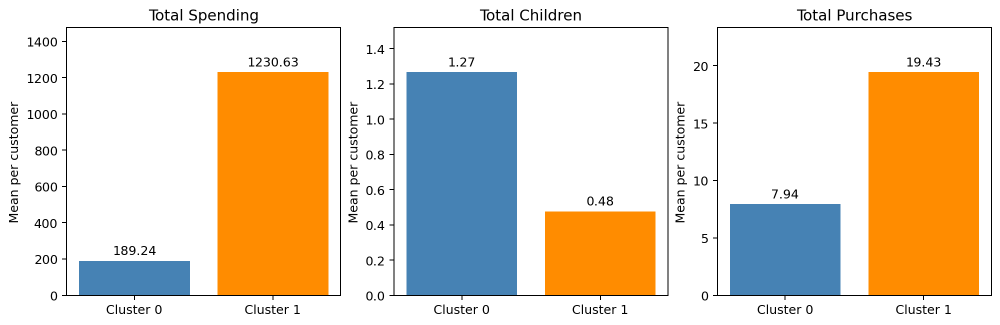

Figure 6. Spending, children and purchases by segment. Purchases were not a clustering input.

Cluster 0 is a reasonable audience for testing value offers or family bundles. Cluster 1 is a reasonable audience for testing premium offers or retention activity. These are proposals to test, not demonstrated campaign effects. Mean recency differs by only 1.10 days, so the higher-spending group is not clearly more recently active. Spending also does not establish profitability without cost and margin information.

### Education and complaints

Education and Complain were held out of clustering. Pearson chi-square tests, without continuity correction, check their association with the segments; Cramér's V measures the strength of that association. The procedure follows [SciPy's chi-square documentation](https://docs.scipy.org/doc/scipy/reference/generated/scipy.stats.chi2_contingency.html).

| Attribute | Chi-square | df | p-value | Cramér's V | Smallest expected count |
| --- | ---: | ---: | ---: | ---: | ---: |
| Education | 45.859 | 4 | 2.63e-9 | 0.143 | 21.6 |
| Complain | 0.393 | 1 | 0.531 | 0.013 | 8.4 |

Education differs across clusters, but its association is modest. All 54 Basic-education customers fall in Cluster 0, while PhD customers account for 19.72% of Cluster 0 and 24.67% of Cluster 1. These are descriptive differences, not evidence that education causes spending.

Complaints show no clear difference: **14/1,344 (1.04%)** versus **7/896 (0.78%)**. All expected counts exceed five, although the total of only 21 complaints limits what can be concluded. Testing differences in the clustering inputs themselves would be circular: those differences were used to form the groups. Small p-values on those inputs would not independently validate the segmentation.

## Task 3 — Comparing clustering methods

Dataset2 contains Compact (400 points), wellSeperated (335), Skewed (925) and Subclusters (400). Each has two numerical coordinates and no missing values. The coordinates are used as supplied; scaling each axis separately would change their geometry.

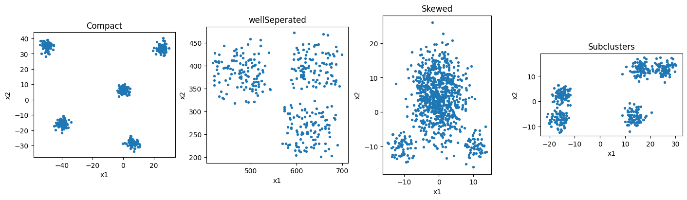

Figure 7. Original data, with equal horizontal and vertical axis scales.

### Parameters

K-Means is tried for k=2–10 with 20 restarts and random seed 42. The selected k is also used for single, complete, average and Ward linkage so their results can be compared at the same number of groups. Euclidean distances are used.

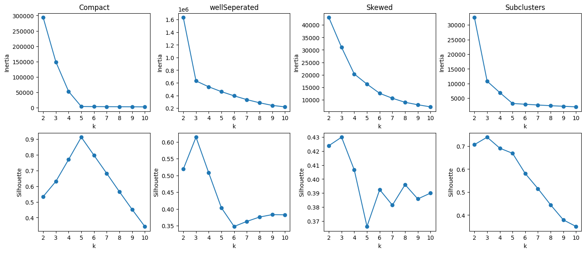

Figure 8. Compact supports k=5 and wellSeperated supports k=3. Skewed has its highest silhouette at k=3 (0.430), with a less distinct elbow.

Subclusters has a strong inertia drop at 3 and another bend at 5. Silhouette prefers 3 (0.739 versus 0.669 at 5). Here, **5** is used to preserve the smaller visible groups. Three remains a valid broader grouping; no reference labels establish a unique correct answer.

DBSCAN uses **min_samples=5** for every dataset. This requires several nearby points in the two-dimensional space rather than allowing isolated pairs to form dense groups. The k-distance plots use the fifth neighbour, counting the point itself, consistently with DBSCAN. The eps choices lie near the upper bends of the plots.

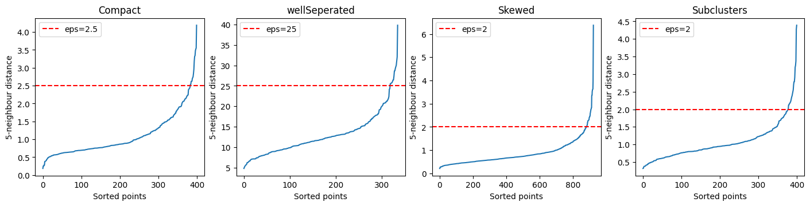

Figure 9. Sorted fifth-neighbour distances and the selected eps values.

| Dataset | K-Means/linkage k | DBSCAN eps | min_samples | DBSCAN clusters |
| --- | ---: | ---: | ---: | ---: |
| Compact | 5 | 2.5 | 5 | 5 |
| wellSeperated | 3 | 25 | 5 | 3 |
| Skewed | 3 | 2 | 5 | 3 |
| Subclusters | 5 | 2 | 5 | 3 |

The eps values are visual choices, not exact optima. Smaller values can fragment a group or mark more points as noise; larger values can connect neighbouring groups. A single threshold can struggle when clusters have different densities.

### Results by dataset

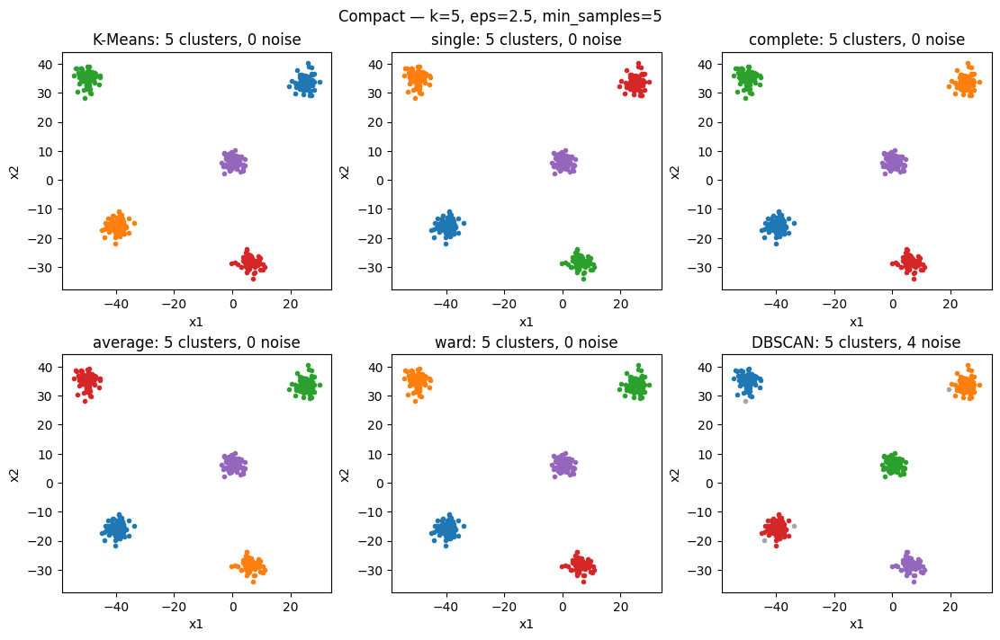

Figure 10. Compact. Grey indicates noise in all cluster plots; colours identify groups within each panel and are not matched between algorithms.

**Compact:** K-Means and all four linkage methods recover the same five groups, each containing 80 points, with silhouette **0.912**. Their compact shape, similar size and clear separation suit K-Means well. DBSCAN gives **0.913** after removing four points; this tiny increase does not establish a better grouping. K-Means is sufficient here.

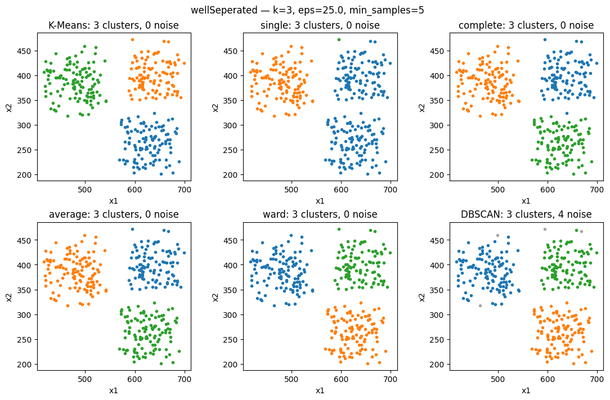

Figure 11. wellSeperated.

**wellSeperated:** K-Means, average and Ward agree, with silhouette **0.614**; complete is close at **0.613**. Single linkage joins nearby groups into a cluster of 213 points and leaves a singleton, giving **0.347**. This is chaining: successive short links can connect otherwise separate groups. DBSCAN identifies three groups but removes four points. K-Means, average and Ward all work well on this dataset.

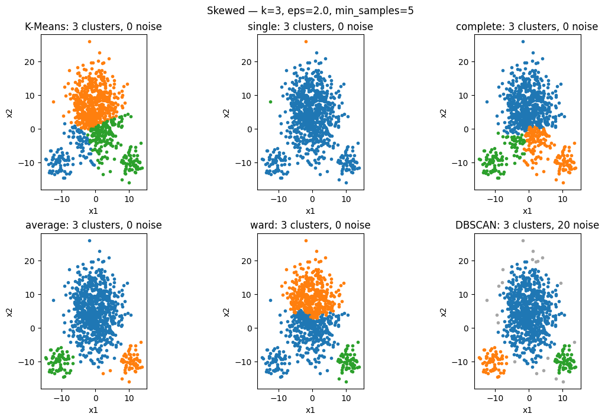

Figure 12. Skewed.

**Skewed:** DBSCAN best follows the large cloud and two small groups in the scatter plot, with silhouette **0.501** and 20 noise points. Average linkage is a useful alternative at **0.492**, retaining every point. K-Means and Ward divide the large cloud because reducing squared distances favours compact groups and responds poorly to unequal cluster sizes and spread. Complete linkage also splits it because it limits the maximum distance within groups. Single linkage chains **923 points** together and leaves two singletons. DBSCAN works well for this chosen density threshold, but its exclusion of sparse points must be considered alongside the score.

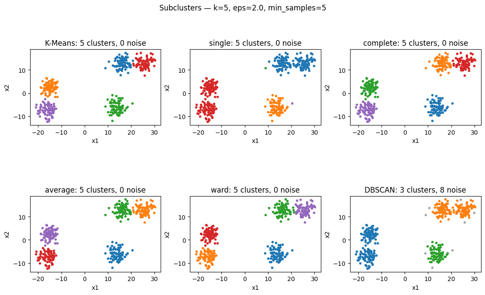

Figure 13. Subclusters.

**Subclusters:** K-Means gives five groups of 80 points and silhouette **0.669**. Complete, average and Ward are close. Single linkage connects neighbouring groups and isolates outlying points. DBSCAN joins nearby groups into three larger ones and scores **0.744**, excluding eight points. K-Means is a reasonable choice when the aim is five smaller groups; DBSCAN gives a coarser view. The higher silhouette alone cannot decide which level is useful.

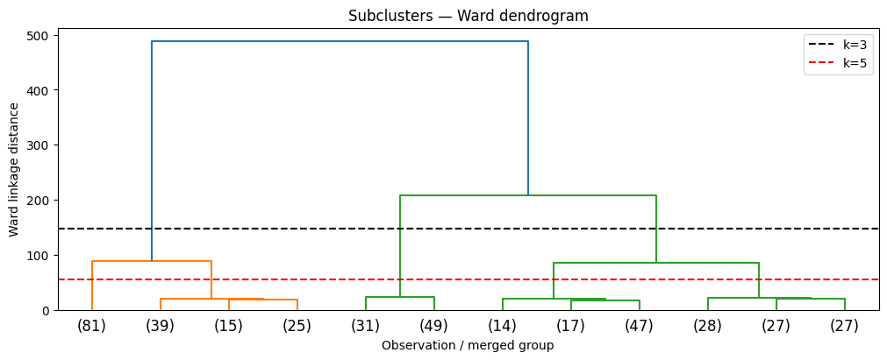

Figure 14. Ward dendrogram, truncated to 12 leaves. Numbers in parentheses are merged group sizes. The cuts show three broad groups and five smaller ones.

### Scores and their limits

Higher silhouette and Calinski–Harabasz (CH), and lower Davies–Bouldin (DB), indicate better separation under these measures. DBSCAN noise is removed before calculating all three scores. Noise percentages use each full dataset.

| Dataset | Method | Clusters | Noise | Noise % | Silhouette | DB | CH |
| --- | --- | ---: | ---: | ---: | ---: | ---: | ---: |
| Compact | K-Means | 5 | 0 | 0.00 | 0.912 | 0.121 | 18329.59 |
| Compact | single | 5 | 0 | 0.00 | 0.912 | 0.121 | 18329.59 |
| Compact | complete | 5 | 0 | 0.00 | 0.912 | 0.121 | 18329.59 |
| Compact | average | 5 | 0 | 0.00 | 0.912 | 0.121 | 18329.59 |
| Compact | ward | 5 | 0 | 0.00 | 0.912 | 0.121 | 18329.59 |
| Compact | DBSCAN | 5 | 4 | 1.00 | 0.913 | 0.119 | 18873.76 |
| wellSeperated | K-Means | 3 | 0 | 0.00 | 0.614 | 0.547 | 792.05 |
| wellSeperated | single | 3 | 0 | 0.00 | 0.347 | 0.647 | 208.58 |
| wellSeperated | complete | 3 | 0 | 0.00 | 0.613 | 0.548 | 789.35 |
| wellSeperated | average | 3 | 0 | 0.00 | 0.614 | 0.547 | 792.05 |
| wellSeperated | ward | 3 | 0 | 0.00 | 0.614 | 0.547 | 792.05 |
| wellSeperated | DBSCAN | 3 | 4 | 1.19 | 0.616 | 0.543 | 800.17 |
| Skewed | K-Means | 3 | 0 | 0.00 | 0.430 | 0.872 | 716.91 |
| Skewed | single | 3 | 0 | 0.00 | 0.211 | 0.500 | 4.23 |
| Skewed | complete | 3 | 0 | 0.00 | 0.441 | 0.819 | 673.82 |
| Skewed | average | 3 | 0 | 0.00 | 0.492 | 0.488 | 433.85 |
| Skewed | ward | 3 | 0 | 0.00 | 0.372 | 0.840 | 635.93 |
| Skewed | DBSCAN | 3 | 20 | 2.16 | 0.501 | 0.476 | 441.09 |
| Subclusters | K-Means | 5 | 0 | 0.00 | 0.669 | 0.464 | 4583.01 |
| Subclusters | single | 5 | 0 | 0.00 | 0.528 | 0.376 | 1314.93 |
| Subclusters | complete | 5 | 0 | 0.00 | 0.668 | 0.465 | 4572.17 |
| Subclusters | average | 5 | 0 | 0.00 | 0.668 | 0.465 | 4572.17 |
| Subclusters | ward | 5 | 0 | 0.00 | 0.668 | 0.465 | 4574.70 |
| Subclusters | DBSCAN | 3 | 8 | 2.00 | 0.744 | 0.342 | 2631.15 |

Compare methods within a dataset, since the datasets have different shapes, sizes and scales. The scores do not always agree: on Skewed, K-Means has higher CH than DBSCAN even though DBSCAN better follows the visible groups. The plots are needed to interpret those differences.

The raw sum of within-cluster distances cannot fairly compare different cluster counts. More clusters allow smaller distances, reaching zero with one point per cluster. K-Means inertia uses squared distances to centres and has this same problem.

Silhouette also favours compact, convex groups. It can reward splitting an elongated group or merging nearby smaller groups even when this misses the structure of interest. Subclusters shows this directly: three groups receive a higher score than five. These metric limitations are discussed in the [sklearn clustering guide](https://scikit-learn.org/1.7/modules/clustering.html).

Ignoring DBSCAN noise can improve its scores by removing difficult or isolated points before evaluation. Its scores here cover **99.00%, 98.81%, 97.84% and 98.00%** of the four datasets. They therefore describe slightly different populations from the other methods. Noise counts and plots need to accompany any claim that DBSCAN performs best.

## Power BI and Python

Power BI suits the customer overview: slicers let a reader explore education, marital status and income bands without editing code. Power Query keeps cleaning steps in order, and the M query records the rules used to produce the cleaned file. This matches the repeatable transformation workflow described in [Microsoft's Power Query documentation](https://learn.microsoft.com/en-us/power-query/power-query-what-is-power-query).

Python suits the experiments in Tasks 2 and 3. Loops make it practical to repeat k values and random seeds, compare implementations, calculate stability and run statistical tests. The notebooks place code, plots and interpretations together. The same saved labels can be joined back to customer IDs to check profiles in original units.

Both tools need explicit decisions. Power Query made the missing-value replacements visible, but the cleaning counts still had to be recorded separately because the final query returns the customer table. In Python, a short change to scaling or an outlier cap changes the distances used for clustering. The missing-age treatment and income cap therefore belong in the report as well as the code.

Power BI's interactive view is more convenient for exploring customer groups, while the Python figures here are fixed views chosen for comparison. The current Power BI correlation table is also fixed, despite appearing beside slicers. For this work, Power BI provides the customer overview and Python provides the repeatable experiments; checking both against the same cleaned CSV keeps the results consistent.

## Conclusions

The visualizations show that spending is strongly associated with purchases and income. The clustering brings these patterns together: 896 customers account for **81.26%** of recorded spending, with higher income, more purchases and fewer children on average. The remaining 1,344 customers form a larger, lower-spending group. This supports testing different offers for the two groups, while keeping a control group to measure whether the offers actually improve outcomes.

The segmentation should remain broad. Its silhouette is only **0.253**, age differs by four years on average, and recency is almost the same. Education has a modest association with membership, while complaints show no clear difference. Neither the visual correlations nor the clusters establish causes or campaign response effects. Campaign outcomes were excluded from clustering and can be used later to evaluate the segments.

Task 3 shows why no algorithm or score is best everywhere. K-Means works well for separated, compact groups; density-based grouping better follows Skewed; and Subclusters admits more than one useful level of detail. For the retailer, the equivalent lesson is to use the two segments as a practical starting point and check their usefulness through campaign results, rather than treating cluster labels as fixed customer identities.

The underlying work is in the [Power Query](../powerbi/query.m), [customer clustering notebook](../notebooks/61_clustering_Part2.ipynb) and [algorithm comparison notebook](../notebooks/61_clustering_Part3.ipynb). Full scores are saved in [kmeans_scores.csv](../results/kmeans_scores.csv) and [clustering_comparison.csv](../results/clustering_comparison.csv); customer memberships are in [customer_clusters.csv](../results/customer_clusters.csv).
